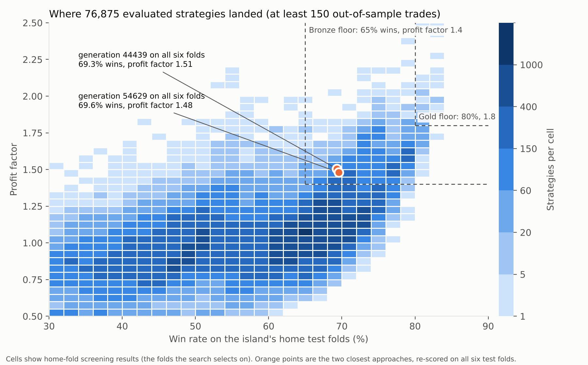
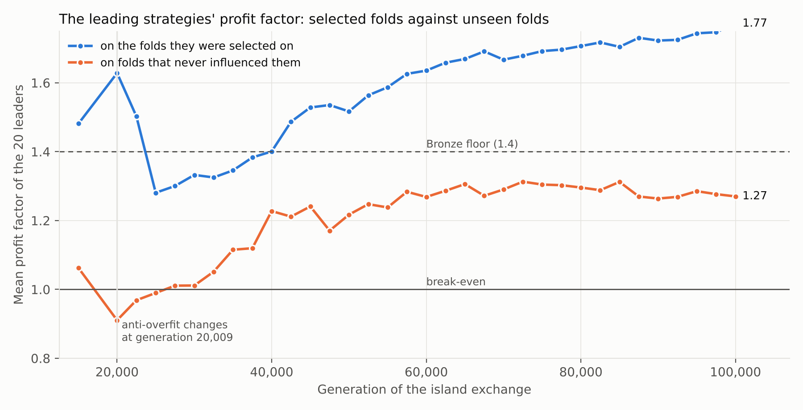

OUTCOME: NONE — no strategy met Bronze. The closest approach, generation 44439, missed the Bronze screen by one gate.

The owner can rely on the harness, on the negative findings and on the measured size of the edge that does exist; the owner cannot
rely on any strategy from this run as certified, and nothing here supports an 80% win rate with a high profit factor.

# Final report at generation 100,000

- Generations completed: 100,000 of 100,000
- Best certified tier: none
- Vault queries used: 0 of 60 (Vault-A), 0 of 5 (Vault-B). The vault and the inner holdout were never opened.
- Pipeline false-discovery rate, latest placebo run: 0 Bronze, 0 Silver, 0 Gold in 1,000 placebo generations (four runs, three decoy types)

## 1. What happened

| Outcome | Generations |
|---|---|
| Failed the stage 1 screen | 99,915 (of which 108 had led the archive and were later removed by an island exchange) |
| Passed stage 1 on their island's folds, then failed confirmation on all six folds | 66 |
| Errored (a harness defect, item 14 of the errata) | 19 |
| Voided by an audit | 0 |
| Confirmed, reached stage 2 | 0 |
| Bronze, Silver, Gold | 0, 0, 0 |

Trial count: 200,156 stage 1 candidate rows in the ledger (two instruments per generation, plus the dry run and re-runs);
about 120,000 effective independent trials after clustering. Canary adoption among stage 1 passes: 0%. The honeypot genome was
voided at all 200 epoch checks. 80 of 80 randomly chosen past generations re-ran from their folders with identical metrics.
The ledger's hash chain is intact (602,419 rows).

## 2. The leading candidate (not certified)

Generation 44439, 15-minute bars. Enter when the net move over 8 bars first exceeds 3 ATR, with price on the trade side of session
VWAP and beyond the cloud; stop 1.5 ATR; half off at half the risk with the stop then moved to entry; target 1.5 ATR; flat by the
close. On all six walk-forward test folds, ES and YM pooled, base costs, 1 contract:

```
Headline win rate (net, flat-to-flat, OOS):   69.3 %   (n = 915 trades)
Wilson 95% interval:                          66.2 % to 72.2 %
Geometry baseline (random-entry twin median): 61.7 %   (200 twins)
Win-rate alpha:                               +7.6 points (twin p99 = 65.0 %)
Random-exit twin win rate:                    56.4 %
Payoff ratio:                                 0.67
Profit factor:                                1.51
Expectancy per trade:                         +9.5 ticks   (+4.1 x round-trip cost)
Largest loss / average win:                   3.5
Trades per year per instrument:               158
Sessions with a trade:                        53 %
```

It failed one gate: one fold supplies 35.9% of the profit and the limit is 35%. The gate was not relaxed. The full evidence, the
Gold vector item by item and the known weaknesses are in `deliverables/DOSSIER.md`. In short: no lookahead and no dependence on
intrabar ordering, profitable at doubled costs and on the inverted market, no edge on decoys; but profit factor 1.86 in 2021,
1.53 in 2022 and 1.14 in 2023, 1.80 on ES against 1.21 on YM, about 1.1 to 1.2 on neighbouring timeframes, and nothing left when
each session's net drift is removed. It is the best of 100,000 attempts, which by itself is not evidence.

The most consistent candidate is generation 25968 (the same entry on 5-minute bars with a structure stop and a 1 ATR target):
73.2% wins over 2,281 trades, twin 66.0%, profit factor 1.19, about 400 trades a year per instrument, every fold profitable,
the same score on folds it was not selected on.

## 3. Frontier



The cells are screening results on the folds the search selects on, so they flatter. Even so the mass sits at 60 to 72% wins with
a profit factor near 1.0 to 1.2. 173 genomes show 80% wins on their home folds with at least 150 trades; all trade fewer than 150
times a year per instrument, and none passed the screen.



This is the central finding. On folds that never influenced them, the 20 leading strategies average a profit factor of about 1.3
from generation 57,500 onward, and the figure stopped rising while the figure on the selected folds kept climbing to 1.77. Forty
thousand further generations added fitting, not edge.

| Trade frequency (per year, per instrument) | Best the search found on unseen folds |
|---|---|
| About 400 | 73% wins, profit factor 1.19 (generation 25968, six folds) |
| About 160 | 69% wins, profit factor 1.51 at its selected timeframe; about 1.1 to 1.2 on neighbouring timeframes (generation 44439) |
| Above 200 with 80% wins | Not found |

**Which constraint binds.** Profit factor on unseen data. A win rate near 70% is reachable with entries that add 4 to 8 points over
their exits' geometry; the payoff ratio that would turn that into a profit factor of 1.4 on every fold is not. Reaching Gold
(80% wins, profit factor 1.8, 200 trades a year) would need roughly three times the entry skill found anywhere in this run.

## 4. What carried information, and what did not

Single-trigger strategies after generation 2,000, median over each trigger's genomes (geometry-matched twins):

| Mechanism family | Median profit factor | Reading |
|---|---|---|
| Canary triggers (no information by construction) | 0.84 to 0.85, alpha 0 | The baseline: costs only |
| Volatility expansion | 1.01 | Small real effect |
| Opening auction | 0.99 | Small real effect |
| Trend continuation | 0.97 (best: ATR-trail flip 1.10, supertrend flip 1.08) | Small real effect |
| Closing auction | 0.95 (late-session extreme 1.11) | Small, low frequency |
| Volatility contraction | 0.94 | Marginal |
| Breakout failure | 0.91 | Marginal |
| Mean reversion to value | 0.85 | Indistinguishable from canaries |
| Inter-market lead-lag | 0.85 | Indistinguishable from canaries |
| Liquidity sweep and reversal | 0.84 | Indistinguishable from canaries |
| Exhaustion | 0.83 | Indistinguishable from canaries |

The owner's own ATR-trail flip is among the best single entries (alpha about +5 points) once it is given a stop, a target and a
flat-by-close rule. Its always-in-the-market original wins 35 to 36% of trades with a profit factor near 1.0.

Atoms that never appeared in a strategy with 65% wins and profit factor 1.2 (at least 100 uses): targets at VWAP and at the
session midpoint, the higher-timeframe extreme sweep, the VWAP retest.

## 5. The 20 most useful lessons

1. A wide stop with a near target produces a 70% win rate with no edge; the random-entry twin catches it every time.
2. The twin must face the same target-to-stop geometry as the candidate, or level-based targets manufacture 20 points of "alpha".
3. A search that selects on three folds overfits them within 15,000 generations: leaders kept 18% of their score on unseen folds.
4. Penalising a record that is much better on the selected folds than before them, and removing leaders that fail on the other
   island's folds, raised that retention to about 60%.
5. After those changes, unseen-fold profit factor plateaued near 1.3; more generations only raised the selected-fold figure.
6. Passing the screen on home folds is weak evidence: 66 did, and all 66 failed on all six folds.
7. The real effects in this data are trend-day effects: they vanish when each session's net drift is removed.
8. Mean-reversion, sweep, exhaustion and lead-lag triggers alone perform like the canaries after costs.
9. Unions of weak entries take the weaker member's quality; ensembles did not add edge.
10. Filters (higher timeframe, volume, VWAP side, trail regime) moved profit factor by a few hundredths, not tenths.
11. Raising the target lowered the win rate about as much as the twin's; exit engineering did not create payoff.
12. Limit entries improved price but were adversely selected: filled trades won less often.
13. The best timeframe of a candidate is partly an artefact: neighbours and shifted bar boundaries give about 1.1 to 1.2.
14. The edge that exists is larger on ES than on YM and weaker on days when the two disagree.
15. It is also decaying inside the research data: 2021 best, 2023 weakest.
16. Partial exits with a break-even stop lift the headline win rate; the twin has the same exits, so alpha is unaffected.
17. On decoy markets with no edge the pipeline promoted nothing in 4,000 generations, and selection alone reached a composite
    score of 0.21 to 0.34 in 1,000: any real score must be read against that.
18. No atom's standalone forward-return effect stood clear of what 170 null tests produce.
19. Rounding in rolling sums flipped tied comparisons; the independent Pine replay found it. Independent re-implementation is worth
    its cost.
20. Every safeguard that fired (twin, exchange, confirmation, honeypot, placebo) fired on something real; none was decorative.

## 6. Harness errata

Fifteen items in `reports/ERRATA.md`, all reported when found. The ones that matter to a reader of the results: six vault bars
were seen once before the specification was read (they inform nothing); the first 2,000 generations used a twin without geometry
matching (their alpha is overstated for level-based targets; all failed anyway); parameter refinement was blocked from generation
2,001 to 2,868; 19 generations errored on a defect introduced with engine 1.4.0; the Strategist reviewed at generations 2,000,
20,000 and 30,000 instead of every 1,000; the ENSEMBLE operator arrived at generation 20,009; adversarial market generation,
forward incubation and the lesson re-tests were not built. Atoms were written from call statistics and cluster summaries, not by
reading scripts cluster by cluster.

## 7. Recommendations

1. **Do not trade any strategy from this run as certified.** If you want to watch one, paper-trade generation 44439 or 25968 through
   your existing webhook in paper mode; the Pine files, parity results and check sheets are in `reports/candidates/`. Verify the
   server-side handling of stop and target exits first, because your original strategy had none.
2. **The single most valuable next step for evidence** is a less correlated instrument (NQ, RTY, CL or GC) dropped into
   `data/raw/` and held as pure out-of-sample data, together with forward paper trading. ES and YM are nearly one market.
3. **Decide which requirement to trade off**, in `OWNER_OVERRIDES.md`. The data supports roughly 70% wins with a profit factor of
   1.2 to 1.3 at 150 to 400 trades a year. 80% with 1.8 at 200 trades a year is not supported. A lower profit-factor floor, a
   lower frequency floor, or a different market are the honest options; that choice is yours.
4. **The vault and the inner holdout are untouched.** They remain a clean test for whatever you decide next. Spending a vault query
   on the current candidates would not be justified: neither passed stage 1.
5. Finer data (1-minute bars or ticks) would remove the intrabar ambiguity and let the 5-minute candidates be tested properly.

## 8. Limits of the evidence

Two highly correlated instruments; regular hours only; 5-minute bars with unknown intrabar order; about four years of research
data (2020 to April 2024); no live fills; no vault result. Timeframes below 5 minutes cannot be tested with this data. Nothing here
is financial advice, and no backtest result is a promise of live performance.
