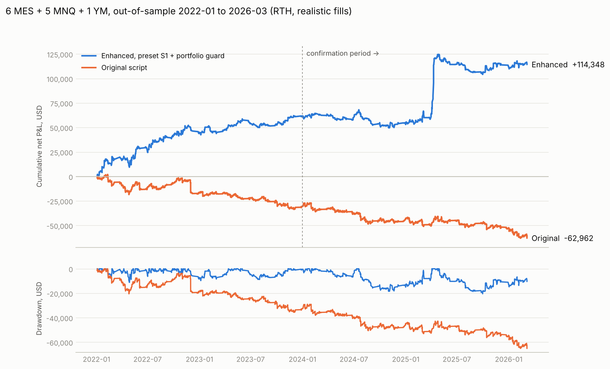

# Smart Trend + HMA + RSI — enhancement research

All 13 proposed enhancements are built, tested and reported here. The research uses 6 years of
5-minute regular-trading-hours (RTH) data for ES, MES, MNQ, YM and MGC, from 2020-01 to 2026-03.

| File | What it is |
|---|---|
| `pine/SmartTrend_Enhanced.pine` | The enhanced TradingView strategy (Pine v6). The original signal engine is unchanged, and every enhancement is an input. |
| `st/` | Python research engine: indicators, signal logic, a bar-by-bar simulator with TradingView fill rules, filters, meta-model, portfolio |
| `run_baseline.py` | Original strategy on the 6-year data, reconciled against your TradingView exports |
| `run_final.py` | End-to-end evaluation: walk-forward model, stacked enhancements, portfolio, model export |
| `run_bias.py` | Long-bias diagnosis after the forward test, and fixes |
| `run_new_markets.py`, `run_portfolio_v2.py` | Cross-market test on RTY/M2K/MYM/MCL and portfolio choices |
| `run_exit_modes.py`, `run_hybrid.py` | Exit-comparison script's models (Original / Timed / Trend runner) and hybrids |
| `make_charts.py` | Equity-curve chart |
| `tests/` | Look-ahead (causality) tests and logic checks |
| `results/` | Metrics CSVs, trade lists, the exported model (`meta_model.json`), `equity_curve.png`, run log |

## Headline (out of sample, realistic fills)

Portfolio: 6 MES + 5 MNQ + 1 YM, about $200k notional per market, 2022-01 to 2026-03.
Fills: 1 tick slippage, limit orders must trade 1 tick through, $2.50 round-turn commission per contract.

| | Original script | **Enhanced (preset S1 + guard)** | Enhanced (preset S4 + guard) |
|---|---|---|---|
| Profit factor | 0.88 | **1.31** | 1.29 |
| Net P&L | −$62,962 | **+$114,348** | +$58,545 |
| Max drawdown | −$65,063 | **−$20,420** | −$12,082 |
| Return / max drawdown | −0.97 | **5.60** | 4.85 |
| Worst day | −$10,300 | **−$3,850** | −$3,382 |
| Profitable months | 39% | **57%** | 61% |
| Sharpe ratio (daily) | −1.15 | **1.42** | 1.57 |
| Trades | 4,542 | 1,334 | 1,384 |

Split into the selection window (2022–23) and the confirmation window (2024–26):

| | 2022–23 PF | 2024–26 PF | 2022–23 max DD | 2024–26 max DD |
|---|---|---|---|---|
| Original | 0.88 | 0.89 | −$35.6k | −$36.1k |
| S1 + guard | 1.35 | 1.28 | −$11.3k | −$20.4k |
| S4 + guard | 1.34 | 1.25 | −$9.9k | −$12.1k |

Per symbol, S1, 1 contract each, profit factor 2022–23 / 2024–26: ES 1.27/1.29, MES 1.18/1.25,
MNQ 1.17/1.18, YM 1.89/1.64. The original scores 0.88–0.95 on every symbol.



### Read this before trading it

- **It depends on big trend days.** Profit factor drops to **1.16** without April 2025 (the
  tariff-shock month, +$58k), and to **1.07** without the 10 best days. Expect long flat
  stretches. 2024 lost (PF 0.89, −$8.6k), and May 2025 to March 2026 is −$7.7k. S4 depends less
  on outliers (PF 1.21 without April 2025, 1.10 without the top 10 days) but makes less money.
- **The edge has been weaker recently.** Since mid-2025 the equity curve is flat to down. The
  model is retrained every January, so the 2026 model includes 2025, but there's no guarantee it
  adapts.
- **MGC (gold) is excluded.** The signal and the model lose money on gold in every variant
  (PF 0.66–0.88).
- **RTH chart required.** The model was trained on 09:30–16:00 New York bars. On an
  extended-hours chart the ATR, RSI and trail values differ, so the model's inputs differ.
- **The Pine Script hasn't been compiled here** (no TradingView in this environment). Load it,
  run it on a 5-minute RTH chart of MES/ES/MNQ/YM, and send back the List of Trades so I can
  reconcile it with the Python engine.

## Key findings that drove the design

1. **The HMA leg is degenerate.** With length 2, `ta.hma(close, 2) = close + (close − close[1])/3`.
   So "close crosses over the HMA" happens exactly when the close is *lower* than the prior close:
   an HMA "buy" fires on a down bar. Combined with the conflict-reset rule, this means **Smart
   Trend flips never become trades. Every trade comes from the pullback-recovery signal.**
   Replacing the leg (HMA 9/21, or removing it) made results *worse*, so the accidental "enter
   on a counter-bar" timing is kept.
2. **The original target is `min(1.25 × ATR, $150)`.** On full-size contracts the $150 cap
   always applies: 3 points on ES, 7.5 on NQ, 0.03 on SI. That is why those symbols win 85–90%
   of trades and still lose money.
3. **The raw signal has no edge after costs.** The average move after a signal is about
   +0.10 ATR, while costs are about 0.15–0.2 ATR. Across 360 stop/target/time-limit combinations
   the best profit factor is about 1.04. No exit design can rescue it on its own.
4. **Static filters tuned on 2020–23 failed on 2024–26.** Efficiency ratio, VWAP extension,
   15-minute agreement and late-session timing all looked strong in-sample and turned flat or
   negative out of sample.
5. **A walk-forward meta-label model fixes the selection problem.** It's a logistic regression
   on 24 causal features, pooled across the index futures and retrained every January on
   earlier years only. Selected trades score PF 1.36–1.53 out of sample, across every
   regularisation strength and every stop from 2 to 4 ATR, against about 1.05 for all signals.
   The coefficients keep the same sign in every training window. The model favours:
   - price near the day's high (low for shorts);
   - later in the session;
   - DMI agreeing with the trade;
   - a gap in the trade direction.

   It penalises shock bars and an overstretched RSI, and it prefers the 60-minute trend to be
   still *against* the trade, which catches early trend-day turns.
6. **Wrong sizing kills it.** The edge sits in higher-ATR trades. Sizing by fixed dollar risk
   down-weights those trades, and MES and MNQ fell to PF about 1.0. Use fixed contracts.

## All 13 enhancements: what each one did

Each was tested on top of the meta-filter strategy (2022–26, per symbol) unless noted.

| # | Enhancement | Result | In the final config? |
|---|---|---|---|
| 1 | Exit when the Smart Trend regime flips | Net −35%, lower PF | Off (input available) |
| 2 | Time stop for trades that don't follow through | Neutral to slightly worse | Off (input available) |
| 3 | Volatility-shock guard (range > x ATR, ATR spike) | No change (the model already uses bar range) | Off. "Skip the first 30 min" is in preset S4 |
| 4 | Emergency stop + daily loss limits | 3 ATR stop: worst day −$5.2k → −$3.1k (1 contract per symbol). Max-losers/day is in S4 | **3 ATR stop on**; daily rules in S4 |
| 5 | ATR target/stop with no $150 cap | Removing the cap helps. A fixed target then hurts: hold to the session close is best | No fixed target |
| 6 | Scale out half + break-even + chandelier runner | Lower drawdown, less net, least outlier-dependent | Preset **S4** |
| 7 | Replace HMA(2) | Worse (gPF 0.91 → 0.83–0.88) | Original kept |
| 8 | Trend-quality filter (ER / ADX) | Failed out of sample as a static filter | Used as model features |
| 9 | Higher-timeframe agreement (15m / 60m) | Failed out of sample as a static filter | Used as model features |
| 10 | Location filter (VWAP / trail distance) | Failed out of sample as a static filter | Used as model features |
| 11 | Meta-label ML filter (walk-forward) | **PF 0.92 → 1.35 per symbol** | **On** |
| 12 | Regime-adaptive exits (scale out only if ER ≥ 0.3) | Similar to S2 | Input available (S3) |
| 13 | Correlation guard (max 2 index positions) + portfolio daily stop | DD −27.1k → −20.4k, worst day −5.4k → −3.9k, net −24% | **On** (operating rule) |
| – | Size by risk (fixed $ per trade) | Rejected: removes the edge (see finding 6) | Off |
| – | Adaptive on/off switch from recent signal performance | No consistent value | Not built into Pine |
| – | Realistic fills (target must trade 1 tick through) | Original PF 0.95 → 0.91 | Used in every test |

The final configuration (S1 + guard) was chosen by return/drawdown on **2022–23 only**.
2024–26 was not used for any choice. The one exception is the 3 ATR label stop: the exit grid
that suggested it looked at both windows, but the meta-model result holds for every stop
from 2 to 4 ATR.

## Forward test on TradingView (Aug 12 – Nov 19, 2026): negative

You ran `SmartTrend_Enhanced.pine` (preset S1, 1 contract) on TradingView over a period that
starts after the research data ends (March 2026), so this is a true forward test.

| Market | Enhanced: net | Enhanced: PF | Longs / shorts | Original, same window: PF |
|---|---|---|---|---|
| ES | −$6,250 | 0.66 | 41 / 4 | 0.98 |
| MES | −$1,008 | 0.55 | 43 / 4 | 0.61 |
| MGC (not recommended) | −$292 | 0.90 | 39 / 6 | 0.92 |
| GC (not recommended) | −$5,172 | 0.82 | 37 / 8 | 0.72 |
| CL (not recommended) | −$8,032 | 0.61 | 40 / 17 | 0.88 |

**Diagnosis (`run_bias.py`): the meta filter is long-biased.** Out of sample in 2022–26 it takes
65–86% longs (raw signals are 50/50), and its edge is almost all on the long side: long PF 1.48,
short PF 0.97. It learned to trade *against the 60-minute trend near the day's extreme*. In
2020–25 equity indices that meant buying intraday dips, which paid. Aug–Nov 2026 was a
falling market (ES −6.5%, gold −18%), so it kept buying dips that kept falling.

Fixes tested (portfolio, profit factor):

| Variant | 2022–23 | 2024–26 | 2022–26 | Max DD |
|---|---|---|---|---|
| Current model | 1.35 | 1.28 | 1.31 | −$20.4k |
| **Long-only** | 1.57 | **1.41** | **1.49** | **−$16.6k** |
| Daily-trend gate (50-day) | 1.54 | 1.06 | 1.24 | −$19.0k |
| Per-direction thresholds (50/50) | 1.29 | 1.09 | 1.18 | −$26.9k |
| Model + daily-trend features (picked by the 2022–23 rule) | 1.44 | 1.26 | 1.34 | −$19.7k |

- **Shorts have no edge in any variant.** Long-only is the strongest historically, profitable in
  every year including 2022. In the forward window, though, it would have done **worse**: the
  longs lost, the few shorts won.
- **The daily-trend features don't fix the bias.** The 20-day and 50-day terms take opposite
  signs and mostly cancel, and the variant is no better in 2024–26. The current model is kept.
- **A "Trade direction" input** (Both / Long only / Short only) is now in the Pine Script.

**Bottom line:** the historical edge is mostly *buying intraday dips in equity-index uptrends*.
That's a real, persistent pattern, but it fails in sustained declines, as Aug–Nov 2026 shows.
Don't trade it live on the strength of the backtest. Paper-trade it, and treat a falling
market as the scenario where it loses.

## Exit-comparison script (Timed exit / Trend runner)

Both uploaded "One-Year Exit Comparison" exports use the **Original** exit model:
- `f74570fd` is trade-for-trade identical to the earlier MNQ one-year export (1,363 trades, PF 1.02).
- `e67abe40` is the same run ending three days earlier (1,341 trades, PF 1.03).

So the three exit models were tested here on the 6-year RTH data (`run_exit_modes.py`,
`run_hybrid.py`).

**Raw strategy** (no meta filter), 1 contract per symbol, 2020 – Mar 2026, geometric-mean PF
across ES/MES/MNQ/YM/MGC:

| Exit model | Gm. PF | Net |
|---|---|---|
| Original (capped target) | 0.90 | −$55k |
| Timed exit (1.25 ATR target, 12 bars) | 0.93 | −$15k |
| **Trend runner (exit on regime flip)** | **1.01** | **+$109k** |

The Trend runner is a real improvement over the original exit, but on its own it's still about
break-even.

**With the meta filter, portfolio** (6 MES + 5 MNQ + 1 YM, guard on, profit factor):

| Exit | 2022–23 | 2024–26 | 2022–26 |
|---|---|---|---|
| S1: hold to close (default) | 1.35 | **1.28** | **1.31** |
| Trend runner | 1.44 | **0.92** | 1.14 |
| Hybrid: flip exit after +0.5 ATR (picked by the 2022–23 rule) | **1.49** | 0.99 | 1.21 |
| Hybrid: flip exit after +1.5 ATR | 1.39 | 1.24 | 1.31 |

The runner and the aggressive hybrid won 2022–23 and failed 2024–26, so the default stays S1.
Both are available as Pine presets ("Trend runner", "Runner after +1.5 ATR") for forward
comparison. This also shows that a winner on the selection window can fail. S1 passed the same
test, but each extra round of selection raises the chance of a fluke.

## New markets: RTY, M2K, MYM, MCL (cross-market test)

The walk-forward model trained **only on ES/MES/MNQ/YM** was applied unchanged to markets it
never saw (`run_new_markets.py`). The exit is S1 (3 ATR stop, hold to close), 1 contract.

| Market | Original | S1 exit, no filter | **S1 + meta filter** | Meta-filter PF, 2022 → 2026 |
|---|---|---|---|---|
| MYM | 0.91 | 1.04 | **1.62** | 1.99, 1.24, 1.08, 1.78, 1.79 |
| RTY | 0.98 | 1.07 | **1.17** | 1.50, 1.48, 0.82, 0.78, 1.52 |
| M2K | 0.81 | 0.97 | **1.05** | 1.47, 1.44, 0.66, 0.58, 1.29 |
| MCL | 0.74 | 0.80 | 0.77 | 1.01, 0.63, 0.59, 0.65, 0.98 |

- **The filter generalises.** It improved every unseen index market in both periods, which is
  evidence it isn't just fitted to ES/NQ/YM.
- **The Russell lost money in 2024–25 even with the filter.** The edge varies over time and is
  strongest in the Dow and S&P.
- **M2K is worse than RTY on identical prices because of commission.** $2.50 per round turn is a
  large share of a $5-per-point contract. Your real micro commission matters.
- **Crude (MCL) fails, like gold.** This is an equity-index strategy only.

Portfolio choices (`run_portfolio_v2.py`), chosen on 2022–23 by return/drawdown, profit factor:

| Training pool / portfolio | 2022–23 | 2024–26 | 2022–26 | Max DD |
|---|---|---|---|---|
| **ES/MES/MNQ/YM pool, 6 MES + 5 MNQ + 1 YM (selected)** | 1.35 | 1.28 | 1.31 | −$20.4k |
| same pool, 6 MES + 5 MNQ + 10 MYM (all micro) | 1.32 | 1.25 | 1.28 | −$22.7k |
| same pool, all micro + 16 M2K | 1.29 | 1.08 | 1.18 | −$27.7k |
| pool + MYM/RTY/M2K, 6 MES + 5 MNQ + 1 YM | 1.36 | 1.23 | 1.29 | −$16.1k |

Decision: keep the model and its Pine coefficients as they are. **Trade ES/MES, NQ/MNQ and
YM/MYM only**; MYM is the small-account substitute for YM. Leave out the Russell, crude and gold.

## Using the Pine Script

1. Open a **5-minute** chart of ES/MES, MNQ (NQ untested) or YM/MYM. Not the Russell, crude or gold. Set
   the session to **regular trading hours**.
2. Add `SmartTrend_Enhanced.pine`. Preset **Selected (S1)** is the tested default. **Smoother
   (S4)** trades lower drawdown for lower profit.
3. Sizing: **fixed contracts** ("Size by risk" off). The research used about $200k notional per
   market (6 MES / 5 MNQ / 1 YM). Scale down to what your account's drawdown limit allows.
   For example, 1 MES + 1 MNQ + 1 MYM is roughly 1/6 of the research size, so expect a max
   drawdown of about −$3.5k and a worst day of about −$650.
4. Portfolio rules (can't be enforced inside a single-symbol script; apply at account level):
   - at most **2 index positions open** at a time;
   - stop for the day after the portfolio is down **$1,500** at the research size; scale this
     with your size.
5. A score label prints the model probability on every raw signal. Faded circles are signals the
   filter skipped.

## Reproduce / extend

```bash
pip install numpy pandas numba scikit-learn lightgbm matplotlib pytest
```

```bash
python3 run_baseline.py
```

```bash
python3 run_final.py
```

```bash
python3 make_charts.py
```

```bash
python3 -m pytest -q tests
```

Data goes in `data/<SYMBOL>_5min_RTH.csv` (Databento-style columns
`ts_event,symbol,open,high,low,close,volume`). The data files are git-ignored. New index
symbols (MYM, M2K, RTY, NQ) are picked up automatically by `run_final.py` once their files are
present, and the model is retrained to include them. Non-index markets (MCL, gold) need their own
evaluation: the model is index-only.
